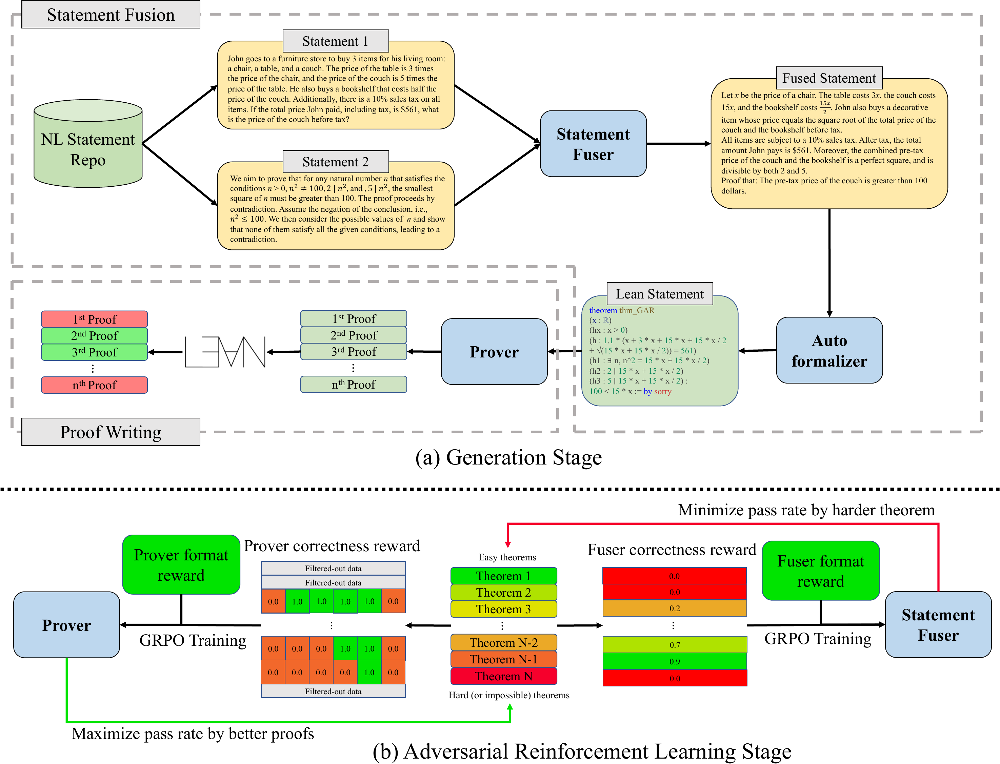

# GAR-Official
This is the official training code implementation of *GAR: Generative Adversarial Reinforcement Learning for Formal Theorem Proving*. 
The trained model is available at:
* GAR_Goedel-Prover-V2: https://huggingface.co/RickyDeSkywalker/GAR_Goedel-Prover-V2
* GAR_DeepSeek-Prover-V2: https://huggingface.co/RickyDeSkywalker/GAR_DeepSeek-Prover-V2/

The base datasets are available at:
* Original base dataset: https://huggingface.co/datasets/RickyDeSkywalker/GAR_baseDataset
* Base dataset under Numina-Math: https://huggingface.co/datasets/RickyDeSkywalker/GAR_baseDataset_NuminaMath

## Introduction



We introduce *GAR: Generative Adversarial Reinforcement Learning*, an RL training method that intends to solve inefficiency and suboptimial performance in formal theorem prover training caused by fixed problem sets. GAR jointly trains the problem composer and solver in an adversarial loop, which introduces an implicit curriculum learning mechanism, aligning the task difficulty with the prover's evolving capability to improve training efficiency and enabling stronger model performance. Experiments indicates that GAR trained model achieves an avarage of 4.20% of enhancement on MiniF2F-Test under pass@32, and improve the DeepSeek-Prover-V2's pass@32 performance on ProofNet-Test from 22.58% to 25.81%. Beyond theorem proving, GAR establishes a general RL paradigm for co-evolution of problem generation and solving under verifiable environments. 

## Training Guide

### Clone repository

Clone the repo using the following command:

```bash
git clone --recurse-submodules git@github.com:RickySkywalker/GAR-Official.git
```

### Init Lean server

We apply KiminaLeanServer as the Lean verification server. It can be initialized by:
```bash
cd KiminaLeanServer
cp .env.template .env
docker compose up -d
```

### Setup environment

The environment can be set up by running the following command:

```bash
conda env create -f environment.yaml
```

### Clone base dataset

Clone and transform the dataset into JSON form:

```python
from datasets import load_dataset
ds = load_dataset("RickyDeSkywalker/GAR_baseDataset_NuminaMath")
ds["train"].to_json("./base_data/GAR_base_data_Numina-Math.json")
```

### Run training

The GAR training can be initialized throught the following command, detailed training config can be found in `./main.py`.

```bash
python -u ./main.py \
    --training_name GAR-Prover \
    --base_data_path ./base_data/GAR_base_data_Numina-Math.json
```

## Citation
```bib
@article{wang2025gar,
  title={GAR: Generative Adversarial Reinforcement Learning for Formal Theorem Proving},
  author={Wang, Ruida and Yao, Jiarui and Pan, Rui and Diao, Shizhe and Zhang, Tong},
  journal={arXiv preprint arXiv:2510.11769},
  year={2025}
}
```

## Acknowledgement
This material is based upon work supported partially by NSF under Grant No. 2416897, Grant No. 2505932, and by ORN under Grant No. N000142512318. This research used both Delta (NSF award OAC 2005572) and DeltaAI (NSF  award OAC 2320345) advanced computing systems, and computing resources provided by NAIRR Pilot NAIRR250157.